# Aula10 - BackEnd de gestão de resíduos

### Descrição do projeto: <br>
A prefeitura de Amparo necessita realizar o Monitoramento de pontos de descarte irregular, para isso foi desenvolvido um sistema para registrar locais onde foram identificados descartes de lixo, entulho ou resíduos eletrônicos.<hr>
- script.sql
```MYSQL
drop database if exists gestao_residuos;
create database gestao_residuos;
use gestao_residuos;
-- DDL Criação das tabelas
create table usuario (
    id int not null auto_increment primary key,
    nome varchar(100) not null,
    email varchar(100) not null unique,
    senha varchar(100) not null
);
create table ocorrencia (
    id int not null auto_increment primary key,
    usuarioId int not null,
    local varchar(100) not null,
    tipoResiduo varchar(50) not null,
    nivelRisco enum('Baixo', 'Medio', 'Alto') default('Medio') not null,
    data Date default(curdate()) not null,
    status enum('Novo', 'Tratado', 'Pendente') default('Novo') not null
);
alter table ocorrencia add constraint fk_registra
foreign key (usuarioId) references usuario(id);

-- DML para inserir dados de exemplo nas tabelas
insert into usuario (nome, email, senha) values
('Maria Oliveira', 'maria.oliveira@email.com', password('senha123')),
('João Silva', 'joao.silva@email.com', password('senha123')),
('Ana Souza', 'ana.souza@email.com', password('senha123'));

insert into ocorrencia(usuarioId, local, tipoResiduo, nivelRisco, status) values
(1, 'Avenida Osmar Contato, 120', 'Eletrônico', 'Alto', 'Novo'),
(2, 'Rua Osmar Motta, 1313', 'Veículo usado', 'Baixo', 'Pendente'),
(1, 'Rua Lucas trado, 15', 'Eletônico', 'Alto', 'Tratado'),
(2, 'Rua Rolando da Rocha, S/N', 'Móvel usado', 'Medio', 'Novo'),
(3, 'Rua Jacinto Melo, 101', 'Hospitalar', 'Alto', 'Novo');

select * from usuario;
select * from ocorrencia;
show tables;
```

## Método para testar o projeto:
- 1 Clone o repositório
- 2 Abra com VsCode
- 3 Em um teminal CMD ou BASH, digite:
```
npm install
npm run dev
```
- 4 Teste as rotas com a extensão Thunder Client do VsCode ou Insomnia

## Tecnologias:
- VsCode
- Node.js
- JavaScript
- JSON
- Thunder Client

## Rotas - usuarios

| Método | Rota | Descrição |
| :--- | :--- | :--- |
| **GET** | `/usuarios/login` | Faz o login do usuário. |
| **GET** | `/usuarios` | Retorna a lista de usuários. |
| **GET** | `/usuarios` | Retorna um usuário específico pelo id. |
| **DELETE** | `/usuarios` | Remove o usuário referente ao id |
| **POST** | `/usuarios` | Cadastra um novo usuário com auto increment. |
| **PUT** | `/usuarios/id` | Atualiza as informações do usuário pelo id. |

## Rotas - resíduos

| Método | Rota | Descrição |
| :--- | :--- | :--- |
| **GET** | `/residuos` | Retorna a lista de resíduos. |
| **GET** | `/residuos/resumo` | Retorna a ocorrência específica pela situação. |
| **DELETE** | `/residuos/id` | Remove a ocorrência referente ao id |
| **POST** | `/residuos` | Cadastra uma nova ocorrência com auto increment. |
| **PATCH** | `/residuos/id` | Atualiza as informações da ocorrência pelo id. |

## Exemplos de requisição e testes com o Thunder Client

- ### Rota inicial da API:
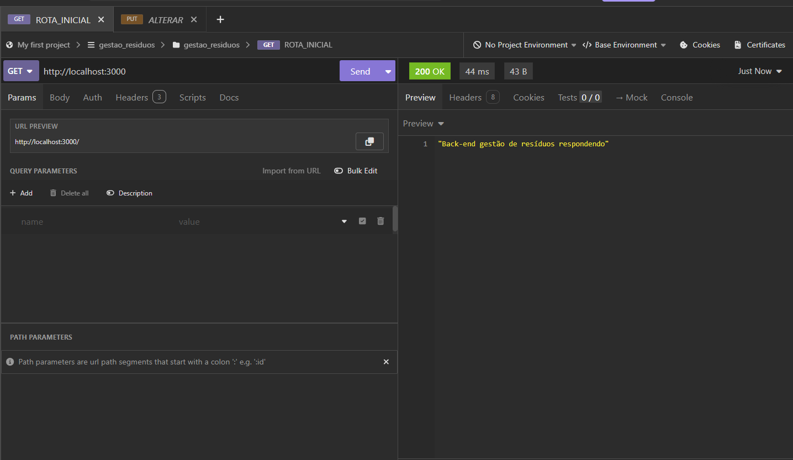

- ### Listar todos os usuários:
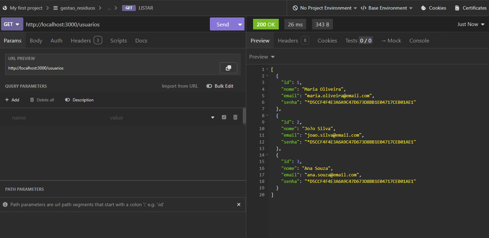

- ### Cadastrar um novo usuário:
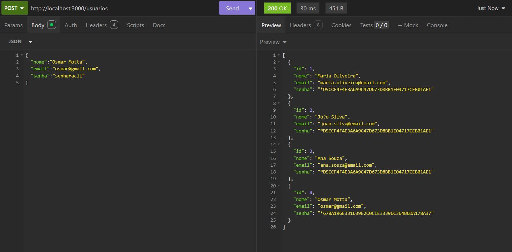

- ### Atualizar informações de um usuário:
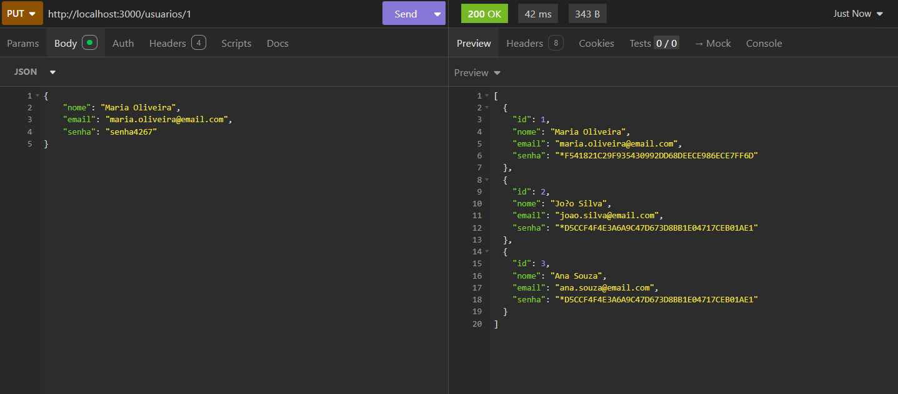

- ### Remover um usuário:
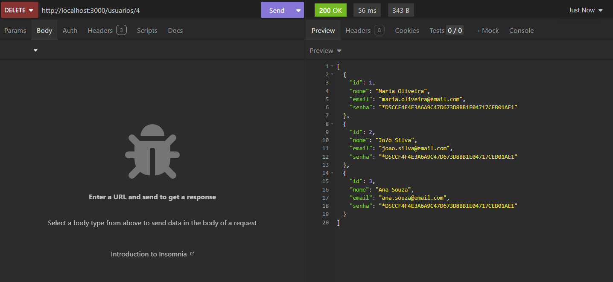

- ### Login realizado com sucesso:
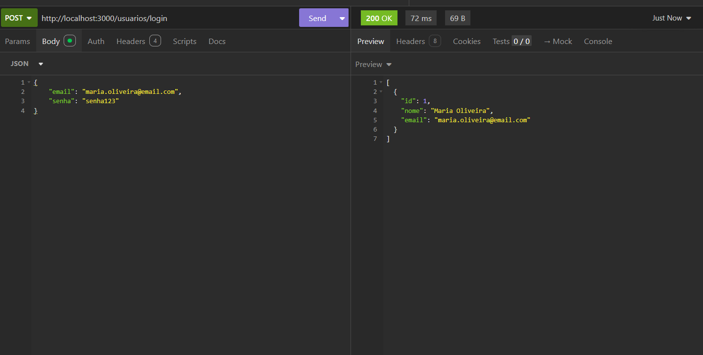

- ### Login negado (credenciais inválidas):
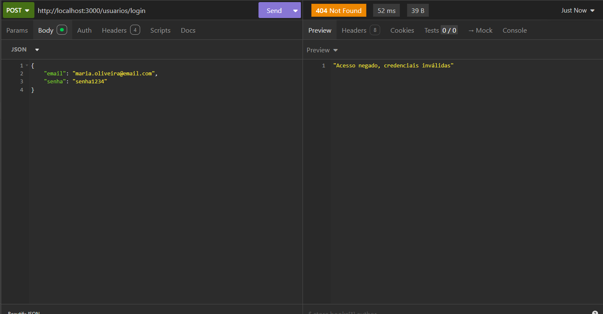

- ### Listar todos os resíduos:
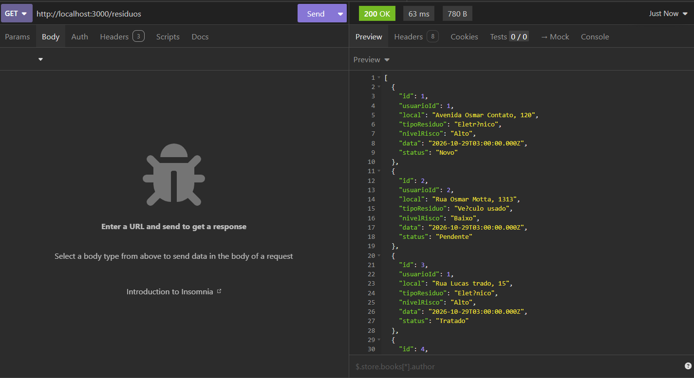

- ### Resumo das ocorrências de resíduos:
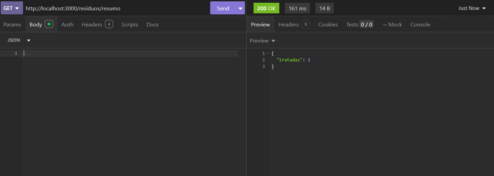

- ### Cadastrar uma nova ocorrência de resíduo:
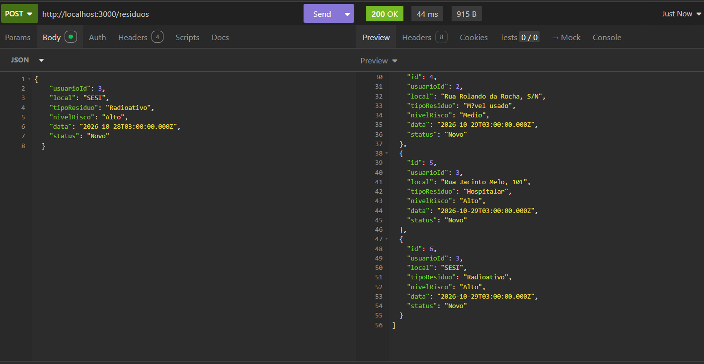

- ### Atualizar informações de um resíduo:
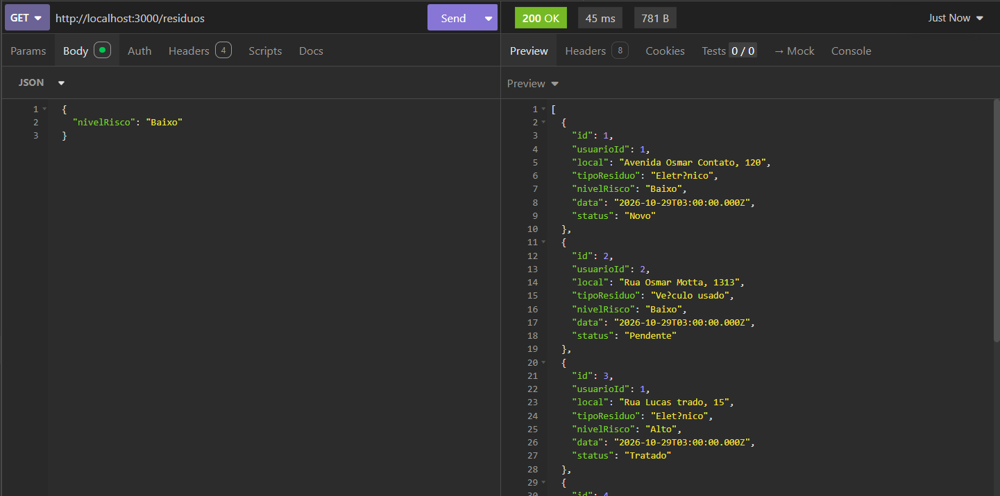

- ### Remover uma ocorrência de resíduo:
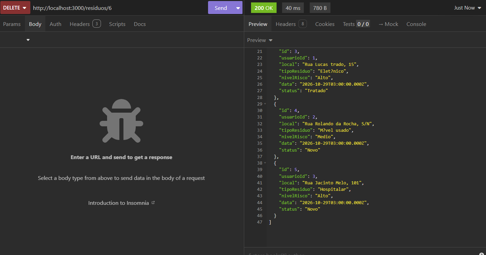

## Diagrama de classes e MER DER conceitual:
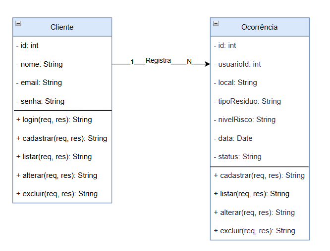
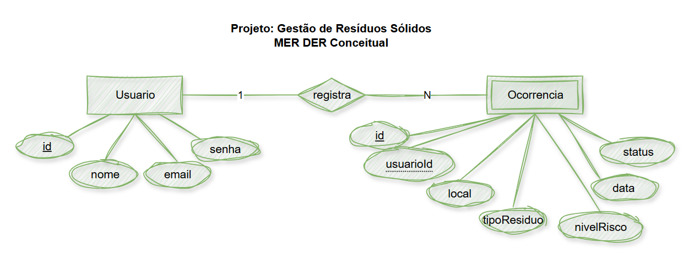
